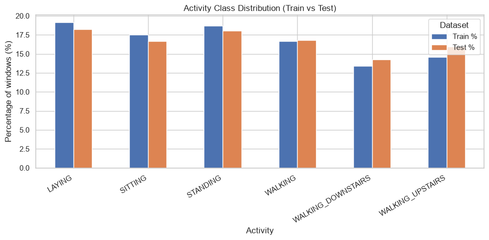
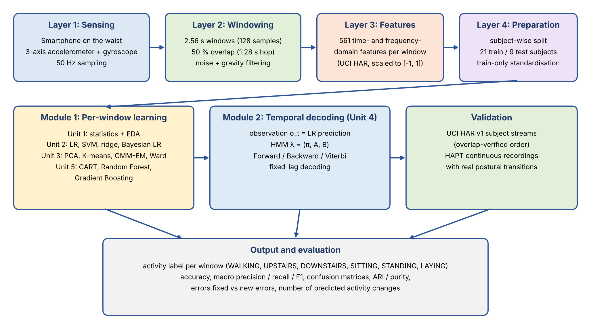
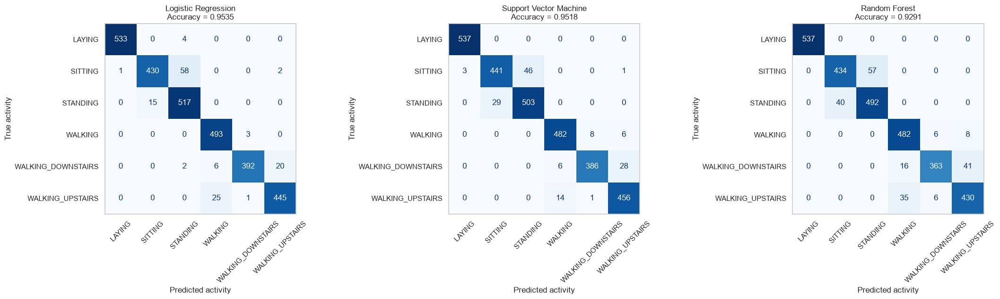
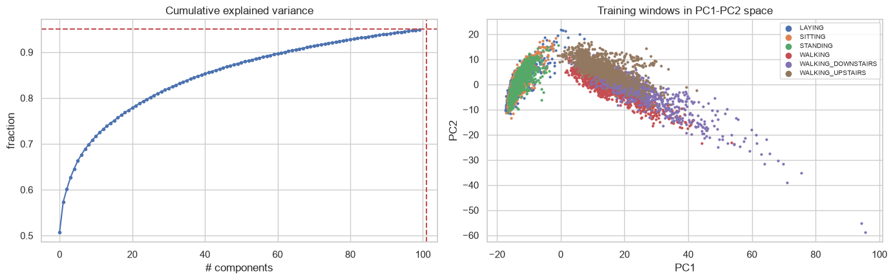
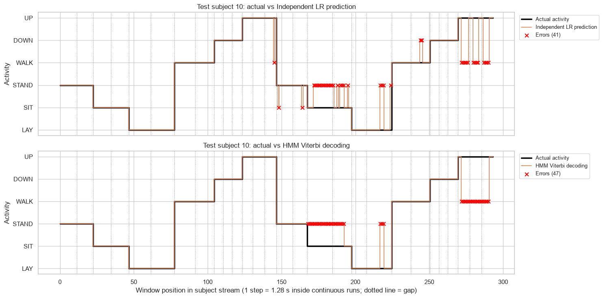

# Human Activity Recognition Using Smartphones

Machine-learning project for **21CSC305P – Machine Learning** (SRM Institute of Science and Technology).
It recognises six everyday activities from smartphone accelerometer and gyroscope signals and covers all five
syllabus units on one dataset: statistics, linear and Bayesian models, unsupervised learning, Hidden Markov Models
and tree ensembles.


| Best single-window classifier | + HMM temporal decoding (UCI HAR) | + HMM decoding (HAPT, real transitions) |
|:---:|:---:|:---:|
| **95.35 %** accuracy (Logistic Regression) | **97.01 %** accuracy (Viterbi) | **97.60 %** accuracy (Viterbi) |

All results are on **9 subjects never seen during training**.

---

## Contents

- [Problem](#problem)
- [Repository structure](#repository-structure)
- [Dataset](#dataset)
- [Pipeline](#pipeline)
- [What is implemented (by unit)](#what-is-implemented-by-unit)
- [Results](#results)
- [How to run](#how-to-run)
- [Evaluation rules](#evaluation-rules)
- [Limitations](#limitations)
- [References](#references)

## Problem

Given a 2.56-second window of smartphone motion signals, described by 561 engineered features, which activity is the
person doing: **walking, walking upstairs, walking downstairs, sitting, standing or laying**? A second question is
how much the windows just before and after help, since real activities last many seconds.

## Repository structure

```
Human-Activity-Recognition-ML/
├── README.md
├── requirements.txt
├── data/
│   ├── README.md                         # column description + optional raw datasets
│   ├── train.csv                         # 7,352 windows, 21 subjects
│   ├── test.csv                          # 2,947 windows, 9 held-out subjects
│   └── external/                         # (git-ignored) raw UCI HAR + HAPT archives, optional
├── notebooks/
│   └── HAR_Classification_Project.ipynb  # the whole project, with saved outputs
└── docs/
    └── images/                           # figures used in this README
```

The notebook keeps all outputs, so it can be read on GitHub without running anything.

## Dataset

**UCI Human Activity Recognition Using Smartphones** (Anguita et al., 2013): 30 volunteers wore a Samsung Galaxy S II
on the waist and followed a fixed protocol of six activities.

| Property | Value |
|---|---|
| Windows | 10,299 (7,352 train + 2,947 test) |
| Subjects | 21 train, 9 test, no overlap |
| Signals | 3-axis accelerometer + 3-axis gyroscope at 50 Hz |
| Window | 2.56 s (128 samples), 50 % overlap → one step = 1.28 s |
| Features | 561 time- and frequency-domain features, scaled to [−1, 1] |
| Quality | no missing values, no duplicate rows, classes close to balanced (13–19 % each) |

<p align="center"></p>

The **HAPT** dataset (same experiment, continuous recordings with labelled postural transitions) is used to validate
the sequence model. See [`data/README.md`](data/README.md) for details and the optional raw downloads.

## Pipeline

<p align="center"></p>

1. **Module 1 – per-window learning.** Every window is classified independently (Units 1, 2, 3 and 5).
2. **Module 2 – temporal decoding (Unit 4).** The predictions of the best classifier become the observations of a
   Hidden Markov Model, decoded online (Forward), with a short delay (fixed lag) or offline (Forward–Backward, Viterbi).

## What is implemented (by unit)

The notebook follows the three project reviews.

| Review | Unit | Topics | Notebook section |
|---|---|---|---|
| 1 | 1 | Probability of each activity, mean/variance, quantiles, covariance, conditional probability and Bayes' rule, IQR outliers, EDA | §2 (incl. §2.10) |
| 2 | 2 | Logistic regression (softmax), RBF SVM, **from scratch:** linear and ridge regression (MLE/MAP), Bayesian logistic regression (Laplace approximation, IRLS), linear SVM (subgradient) | §3–§5, §R2.3–R2.5 |
| 2 | 3 | **From scratch:** PCA (eigen-decomposition), K-means (k-means++), Gaussian mixture via EM, Ward hierarchical clustering (Lance–Williams) | §R2.2, §R2.6–R2.8 |
| 3 | 5 | CART with cost-complexity pruning, Random Forest (bagging), Histogram Gradient Boosting, Gini and permutation importance | Unit 5 extension (§5.5–§5.9) |
| 3 | 4 | Temporal audit of the data, Markov chain, HMM λ = (π, A, B), scaled Forward/Backward, log-space Viterbi, fixed-lag decoding, HAPT validation | Module 2 (§6–§11) |

Every from-scratch model (NumPy only) is checked against scikit-learn in §R2.9: PCA eigenvalues and ridge coefficients
match exactly, and the classifiers and clusterings give identical scores.

## Results

### Single-window classifiers (UCI HAR test, 2,947 windows from 9 unseen subjects)

| Model | Accuracy | Macro-F1 | Train acc. | Fit time (s) |
|---|---:|---:|---:|---:|
| **Logistic Regression** | **0.9535** | **0.9532** | 0.9963 | 0.34 |
| SVM (RBF kernel) | 0.9518 | 0.9511 | 0.9867 | 0.83 |
| Random Forest (200 trees) | 0.9291 | 0.9275 | 1.0000 | 10.79 |
| Histogram Gradient Boosting | 0.9281 | 0.9275 | 0.9992 | 5.14 |
| CART (pruned, ccp_alpha = 0.002) | 0.8694 | 0.8652 | 0.9543 | 2.07 |

<p align="center"></p>

The engineered features are almost linearly separable, so the linear model wins. Static and dynamic activities are
almost never confused; the dominant error for every model is **SITTING predicted as STANDING**.

### Unsupervised learning (no labels used for fitting)

| Result | Value |
|---|---|
| PCA components for 95 % of the variance | 102 of 561 (first two PCs: 57.4 %) |
| K-means (k = 6, first 10 PCs) | purity 0.562, ARI 0.427 |
| Gaussian mixture via EM (diagonal) | purity 0.544, ARI 0.373 (30 EM iterations, log-likelihood non-decreasing) |
| Ward hierarchical (600-window sample) | purity 0.483, ARI 0.356 |

<p align="center"></p>

### Temporal decoding with an HMM (observations = Logistic Regression predictions)

| Method | UCI HAR streams Acc / F1 | HAPT sequences Acc / F1 |
|---|---|---|
| Independent (LR) | 0.9535 / 0.9532 | 0.9551 / 0.9553 |
| Markov chain only | 0.9182 / 0.9169 | 0.9042 / 0.8601 |
| HMM Forward (online) | 0.9535 / 0.9522 | 0.9649 / 0.9648 |
| HMM fixed lag L = 2 (2.56 s delay) | – | 0.9703 / 0.9689 |
| HMM Forward–Backward | 0.9701 / 0.9700 | 0.9728 / 0.9712 |
| **HMM Viterbi** | **0.9701 / 0.9700** | **0.9760 / 0.9739** |

<p align="center"></p>

On UCI HAR, Viterbi fixes 67 of LR's 137 errors and adds 18, and the number of predicted activity changes falls
from 240 to 121 (true: 111). It fixes 85 % of single-window errors but none of the error runs of 5 or more windows.

## How to run

```bash
git clone https://github.com/anshagarwxl/Human-Activity-Recognition-ML.git
cd Human-Activity-Recognition-ML
python -m venv .venv && source .venv/bin/activate   # Windows: .venv\Scripts\activate
pip install -r requirements.txt
jupyter notebook notebooks/HAR_Classification_Project.ipynb
```

- **Module 1, Review 2 and the Unit 5 extension** (§1–§5.9) run with `data/train.csv` and `data/test.csv` only.
- **Module 2** (§6–§11) also needs the raw UCI HAR and HAPT archives in `data/external/`; see
  [`data/README.md`](data/README.md). The saved outputs of these sections are already in the notebook.
- All randomness uses `RANDOM_STATE = 42`. The full notebook takes several minutes on a laptop CPU, mostly for
  cross-validation of the tree models and the HMM emission matrix.

## Evaluation rules

- The official **subject-wise split** is kept: no person appears in both training and test data.
- Scalers, PCA, hyperparameters (ridge λ, Bayesian α, CART ccp_alpha, boosting iterations) and all HMM parameters
  are fitted on **training subjects only**, using subject-held-out validation or `GroupKFold` by subject.
- The HMM emission matrix uses **out-of-fold** predictions, because LR is 99.6 % accurate on its own training rows.
- The test subjects are used once, for final reporting. Clustering never sees labels; they are used only to score the
  clusters afterwards.

## Limitations

- Scripted laboratory protocol and a single phone position; the activity order would not hold in daily life.
- Only 9 test subjects: differences of about 0.001 (3 windows) are within noise.
- UCI HAR removed the transitions between activities; HAPT is used to validate on real transitions.
- The HMM uses hard labels as observations and assumes geometric activity durations.
- SITTING vs STANDING remains the hardest pair for every model.

## References

1. D. Anguita, A. Ghio, L. Oneto, X. Parra and J. L. Reyes-Ortiz, "A public domain dataset for human activity
   recognition using smartphones," *ESANN*, 2013.
2. J. L. Reyes-Ortiz, L. Oneto, A. Samà, X. Parra and D. Anguita, "Transition-aware human activity recognition using
   smartphones," *Neurocomputing*, vol. 171, pp. 754–767, 2016.
3. C. M. Bishop, *Pattern Recognition and Machine Learning*, Springer, 2006.
4. L. R. Rabiner, "A tutorial on hidden Markov models and selected applications in speech recognition,"
   *Proc. IEEE*, vol. 77, no. 2, pp. 257–286, 1989.
5. F. Pedregosa et al., "Scikit-learn: Machine learning in Python," *JMLR*, vol. 12, pp. 2825–2830, 2011.

---

Forked from [Adithya1217/machine_learning_project](https://github.com/Adithya1217/machine_learning_project).
